  

<b>The command line, as an arcade game.</b> 
Where <code>rm -rf</code> goes to get certified.

---

CMDPRO is a retro arcade game that teaches the Unix shell one challenge at a time. You type
real commands into a real-feeling terminal.

A 100-challenge campaign (ending in a 5-challenge bonus round for people who think they've seen
it all), two side quests and three **Special Editions** — 162 challenges in total.

## Features

- **Tutorial** — a guided tour that spotlights every menu, key and command on the real screens,
  then a playable training round (a real challenge where nothing counts) that walks you through
  hearts, hints, recon, the files panel, solutions, saving and themes, step by step. Five
  chapters you can replay one by one, plus a cheat sheet of every game command and key.
- **Campaign** — 7 worlds, 95 challenges from your first `echo` to parsing a port scan, then the
  **Bonus Round** (Roman numerals, anagram groups, bracket hell, dependency hell and Conway's
  Game of Life — in bash): 100 in all. Run out of attempts and it's back to challenge #1.
- **Special Editions** — three standalone seasonal mini-campaigns with their own host, cast,
  pixel art, falling snow/leaves/bats, terminal glyphs and certificate: **Night of the Living
  Shell** (Halloween, 10 challenges, hosted by Zed the zombie sysadmin), **Thanksgrepping**
  (Thanksgiving, 10, hosted by Sir Gobbles the turkey) and **Jingle Shells** (Christmas, a
  25-door advent calendar hosted by Santa Cron). Finishing one unlocks its host as an avatar.
- **Difficulty** — *Easy* (5 attempts, free hints, a lesson before each challenge), *Normal*
  (3 attempts, hints cost points), *Hard* (2 attempts, no hints) and *Extremely Hard*
  (1 attempt, no hints, no pasting — type every key — and a 2–5 minute clock).
- **Certificates, not badges** — the CMDPRO Certificate Authority issues an X.509-flavoured
  certificate for every world (*Foundations*, *Engineer*, *Sr. Engineer*, *Architect*,
  *Principal*, *Expert*, *Guru*), *Machine* for the bonus round, **The Command Line Warrior**
  for finishing on Extremely Hard, *Shell Necromancer*, *Feast Engineer* and
  *Chief Elf Officer* for the special editions, and one for each side quest. Type the name you want printed, then print or save as PDF.
  They live on the **Wall of Certificates** forever, even after a game over.
- **Every other way to solve it** — after each challenge you see the reference answer plus
  curated alternatives (`awk` vs `sed` vs pure bash…) with a note on why each works. The
  alternatives are verified against real bash and the in-browser engine.
- **Recon shell** — `recon` (or F2) opens a private sandbox copy of the challenge to poke around
  in without spending an attempt. `hint`, `files`, `solutions`, `theme`, `focus`, `sound`,
  `save` and `help` are game commands that never cost a heart.
- **Save any time** — progress saves itself after every judged command, and `save`, Ctrl+S or
  the floppy button in the HUD saves on demand. A save also keeps the terminal (scrollback and
  command history), so Continue picks up exactly where you left off; `save export` downloads a
  save file for another device.
- **18 avatars** (Ninja Dave & Ninja Nina, Chill Steve & Chloe, Cozy Don & James, Midnight
  Juan & Mia, Boardroom Ben & Bree, Dapper Dev & Dee, Weekend Hunter & Ally, Robo, Cool Cat,
  Mad Dog and T-Rex) plus three unlockable special-edition avatars (Zed, Sir Gobbles, Santa Cron), and **12
  companions** who join at challenge #4 and rotate every couple of challenges: Sudo the cat,
  Bash the dog, Lionux, Tee-ger, Jag, Spot, Turbo, Daemon the wolf, Echo the parrot, a fish,
  Rocky the rock and B00P the mini computer — and 13 more who only appear in their edition
  (Boo-lean the ghost, Batch the bat, Jack O'Latency, Nutshell the squirrel, Pi, Strawman,
  Rudy the red-nosed router, Jingles the elf, Frosty, Ginger…).
- **13 terminal themes** — Catppuccin Mocha & Frappé, Tokyo Night, Dracula, Monokai, Vim Desert
  and Vim Classic (vim's default colours on black), Rosé Pine Moon, Nord Polar Night & Snow Storm,
  Solarized, Terminal Green (P1 phosphor) and Ember (P3 amber), plus an optional
  CRT effect, **focus mode** (F11, full screen) and adjustable font size. The terminal font is
  **Cardondev Mono** (with a few of its built-in Nerd Font icons in the special-edition prompts).
- **Sound** — CC0 chiptune music and effects, each switchable (or all off) in Settings.
- **Free play** and **side quests** (*Gremlins Ate /bin* — survive on bash builtins — and *The
  Twelve Labors of Bashercules*).